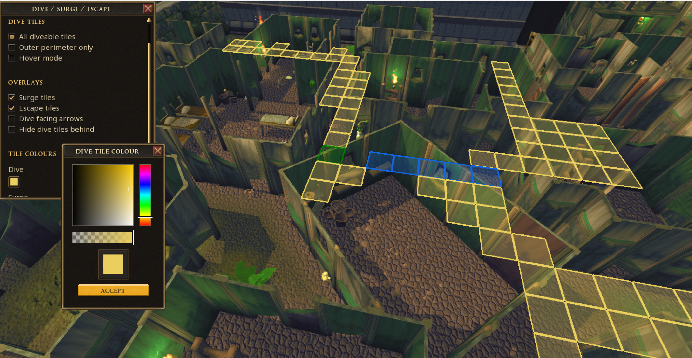

# The Dive Overlay Plugin

This repo encompasses a Runescape 3 Plugin that allows users to see a highlighted mesh of diveable tiles. As Runescape entities can look misleading, and Dive has a somewhat unintuitive algorithm that does not follow traditional line of sight, we hope that this plugin can help enable players to find better pathing in a wide variety of activities!




## Setup

How to use the plugin as a developer.

1. Clone the repo
2. copy the `dive_overlay` folder into your `C:\ProgramData\Jagex\RuneScape-BETA\dev_plugins` folder (or other OS equivalent)
3. `pon dive_overlay`

## Directory
```
dive_overlay/
├── main.lua                                # The main entrypoint
├── plugin.json                             # Plugin metadata
├── README.md                               # What you're reading right. now.
├── maps/                                   # Encoded compressed collision data
│   └── ...
├── src/
│   ├── ui_utils.lua                        # Utilities for the UI
│   ├── dive_utils.lua                      # Dive algorithm and calcs
│   ├── dive_direction.lua                  # Utilities around player direction tracking
│   ├── map_decoder.lua                     # Decodes and caches collision data
│   ├── resolve_procedural_zones.lua        # Utilities for stitching together procedural generation
│   └── collision_manager/
│       ├── collision_manager.lua           # Fetches collision data, dynamics and handles zone checking
│       ├── add_collisions.lua              # Heuristics for dynamic addition of collision data
│       ├── rm_collisions.lua               # Heuristics for dynamic removal of collision data
│       └── special_cases.lua               # LocEntity ids of hardcoded edge cases
```

## How it Works

### Dive Algorithm
Dive (and surge/escape) validate locations by moving towards the targetted tile, checking diagonally, then E/W, then N/S until either the tile is reached, or the pathing gets stuck due to collision with obstacles. Specifically, for each step until the algorithm reaches the target or stalls out, it does the following:

    (If you are not in line with the X,Z axis of the target)
    1. Check the tile diagonal towards the target. Both cardinal adjacent and the ordinal adjacent tile must be free for this to pass.

    (If you are not in line with the X axis of the target)
    2. Check if the tile East or West towards the target is walkable. 

    (If you are not in line with the Z axis of the target)
    3. Check if the tile North or South towards the target is walkable.

    Repeat until you reach target or cannot move in any direction towards the target.

This was implemented in the `isDiveable()` method.

### Collision Data

Runescape cached collision data was downloaded using [this tool](https://github.com/skillbert/rsmv). The collision data keeps a static state of where players can and cannot walk in the game. 

For below, we define a map CHUNK as a 64x64 tile region of collision data. We define a map ZONE as an 8x8 subset of a given map chunk. Procedurally generated areas in Runescape will sample 8x8 zones within a source chunk and rotate them randomly to create a "random" looking area.

The Plugin works by doing the following:

1. On plugin startup, and whenever RegionCreated or [RegionUpdated](https://developer.runescape.com/rs/core/events.html?h=zone#regionupdated) fires, the plugin checks whether the player is in an instance and whether that instance is procedural (e.g., ROTS, Dungeoneering). Procedural instances are identified by examining the source mappings and rotations of neighboring zones.
2. Whenever the player enters a new map ZONE, the plugin checks for what new collision data is needed by observing all map source CHUNKS that intersect with a 32-tile radius around the player.
- Overworld and non-procedural instances: Load any missing 64x64 map chunks intersecting the radius, reusing previously cached data.
- Procedural instances: Resolve the source coordinates and rotation of the surrounding 8x8 ZONES (up to 32 tiles away), in order to properly cache and apply rotatiosn to the collision data. Rotation is resolved by checking movement in the source chunk relative to movement in the randomly rotated map zone.
3. Applies Dynamic collision ADDITION and REMOVAL based on [LocTypes](https://developer.runescape.com/rs/game/config/loctype.html) present.
4. Runs isDiveable() on the 21x21 region of tiles around the player given the finalized collision grid.

### The elephant in the room: Dynamic Collision Data

Runescape does not (yet) expose the dynamic collision data through the API. Hopefully, if this is added, the plugin can become more reliable. This means that when obstacles like barriers dissappear, doors open & close, or wildy spiderwebs get cut, the state of collisions and movement change and deviate from the cached data.

#### Obstacles ADDING collisions

*Note: I am aware of LocAdded and LocRemoved events, these may be a more performant way of detecting changes than my current sampling that I hope to test.*

LocTypes have a few important properties.

`blockWalk`: 0, 1 or 2. 0 if the player can walk through. I assume the values are 1 or 2 if the player cannot walk through, but there are some exceptions to this.

`isHidden`: Whether or not the object is visible in the gamestate.

`isActive`: Indicates whether a LocEntity using this config can be modified by the server.

`shape`: The shape of the object. Helps disambiguate *how* collision should be added by blocking objects.

`rotation`: The rotation of the object occupying the tile.

`size`: e.g. 1x1, 3x3, 5x1... used to fill out all tiles the entity occupies if it's blocking movement.

So if a nearby LocType has `isHidden = False` and `blockWalk != 0`, then I modify the collision data based on the LocType's [shapeType](https://developer.runescape.com/rs/game/config/loctype.html?h=locsh#locshapetype) value:

| LocType.shapeType name              | Value | Behavior |
| :---------------- | :------: | ----: |
| WALL_STRAIGHT        |   0   | Usually doors; Check rotation: 0 = West block, 1 = North block, 2 = East block, 3 = South block |
| WALL_DIAGONALCORNER           |   1   | Don't add collision - NEEDS VERIFICATION (likely adds corner collision) |
| WALL_L    |  2   | Acts like WALL_STRAIGHT until I can verify. NEEDS VERIFICATION. |
| WALL_SQUARECORNER |  3   | Don't add collision - NEEDS VERIFICATION (likely adds corner collision) |
| WALLDECOR_STRAIGHT_NOOFFSET       |   4   | Decor should never add collision |
| WALLDECOR_STRAIGHT_OFFSET           |   5   | Decor should never add collision |
| WALLDECOR_DIAGONAL_OFFSET    |  6   | Decor should never add collision |
| WALLDECOR_DIAGONAL_NOOFFSET |  7   | Decor should never add collision |
| WALLDECOR_DIAGONAL_BOTH        |   8   | Decor should never add collision |
| WALL_DIAGONAL           |   9   | Adds center block (NEEDS VERIFICATION) |
| CENTREPIECE_STRAIGHT    |  10   | The most common shape. Adds center block |
| CENTREPIECE_DIAGONAL |  11   | Adds center block |
| ROOF_STRAIGHT        |   12   | Roofs should never add collision (NEEDS VERIFICATION) |
| ROOF_DIAGONAL_WITH_ROOFEDGE           |   13   | Roofs should never add collision (NEEDS VERIFICATION) |
| ROOF_DIAGONAL    |  14   | Roofs should never add collision (NEEDS VERIFICATION) |
| ROOF_L_CONCAVE |  15   | Roofs should never add collision (NEEDS VERIFICATION) |
| ROOF_L_CONVEX        |   16   | Roofs should never add collision (NEEDS VERIFICATION) |
| ROOF_FLAT           |   17   | Roofs should never add collision (NEEDS VERIFICATION) |
| ROOFEDGE_STRAIGHT    |  18   | 1Roofs should never add collision (NEEDS VERIFICATION) |
| ROOFEDGE_DIAGONALCORNER |  19   | Roofs should never add collision (NEEDS VERIFICATION) |
| ROOFEDGE_L        |   20   | Roofs should never add collision (NEEDS VERIFICATION) |
| ROOFEDGE_SQUARECORNER           |   21   | Roofs should never add collision (NEEDS VERIFICATION) |
| GROUNDDECOR    |  22   | Decor should never add collision |
| WALL_L_ALT |  23   | Acts like WALL_STRAIGHT until I can verify. (NEEDS VERIFICATION) |
| WALLDECOR_DIAGONAL_BOTH_ALT        |   24   | Decor should never add collision |

Ultimately these are just heuristics and exceptions will likely happen when playing the game. (e.g. Dungeoneering Key Doors)

#### Obstacles REMOVING collisions

Think about cutting a spiderweb in the wilderness or the ROTS entry barriers dissappearing after the kill is over. Some obstacles are deliberately placed on top of tiles with cached collisions. These objects then, when modified, act to remove the collsion on the tile.

Currently I have a simple rule that I found to be consistent among most of my test cases. Block walk does not matter here, because LocType entities can have various blockWalk behavior depending on how the player interacts with them. (E.g. the first ROTS barrier is blockwalk=1 since the player cannot pass without pads being filled. The second ROTS barrier is blockwalk=0, since the player can always just left click to pass through it.) What ended up being consistent for me was:
`isHidden=True & (isActive=True | blockWalk=1)`. If this evaluates true, I remove the cached CENTER collision from its footprint, provided there is no overlapping visible Loc that independently contributes CENTER collision.
When directional blocking Locs like doors change, then the original configuration becomes hidden, and therefore collision is removed. `isHidden=True & (shape = 0 | blockWalk > 0)` signifies a rotated door that should be removed as no longer blocking.


#### Hardcoded exceptions

Unfortunately, I have one exception for which I haven't been able to find any change exposed in the Loc data for. The broken ROTS bridges. While an entity gets hidden and a new entity (the broken bridge) appears, both have blockwalk set to 0, indicating they are walkable. Also, the collision data has no blocking on the bridge tiles (probably because the bridges are walkable on the way in). So there is something adding a collision there, and I wasn't able to figure out how to programmatically register it. For now, I have an exceptions file with specific loc IDs that should add collision, but their blockWalk property does not reflect it.

### Direction and Escape/Surge

Player direction is not updated by the `facing` attribute of the Player Entity after using Bladed dive, or turning after a red click.

I haven't accounted for the red click case yet (on the TODOs), but I have a static grid that updates direction for every tile in the 10x10 that one could dive to. This is also what is used in the direction arrows overlay mode.

Escape distance is calculated by accessing the attack range of the player's weapon *if* a ranged weapon is equipped. Tiles are drawn as surge/escape in the direct ordinal or cardinal direction that the player is facing if they are `isDiveable() = True`.
## TODOs
- improve performance? Sampling every frame..?
- better compress data? https://github.com/ThirdAgeStudio/rs3-collision-map
- Improve UI overall
    - minimize button?
- maybe get it to show during an animation? better for agility.. like a lookahead mode, where it shows where you will be 1 tick in the future.
- hover mode, where it shows where you end up based on your cursor hover
- Replace with collisionGrid API if Jagex exposes it. (Remove any and all hardcoding!)

### Perimeter-Only & Don't Look Back Modes

Both of these are post-processing filters that remove tiles for the user to reduce clutter.

The [Flood-fill algorithm](https://www.geeksforgeeks.org/dsa/flood-fill-algorithm/) is used for Perimeter-Only. Basically we start just outside the 21x21 grid and run Depth first search (DFS) to find cardinally connected unreachable tiles, creating the boundary of unreachable tiles connected to the outside. Then, a reachable tile is classified as on the perimeter if a cardinal neighbor is in that unreachable set.

The Don't Look Back Mode computes the dot product between the player direction vector and the player to candidate tile vector. If that dot product is less than zero, then the player is not facing the same way as the candidate tile, and thus the candidate tile is masked.

## Acknowledgements

 Thanks to the community on the Runescape Plugin Development server for helping me understand Dive mechanics properly, and for suggestions on UI and usability.