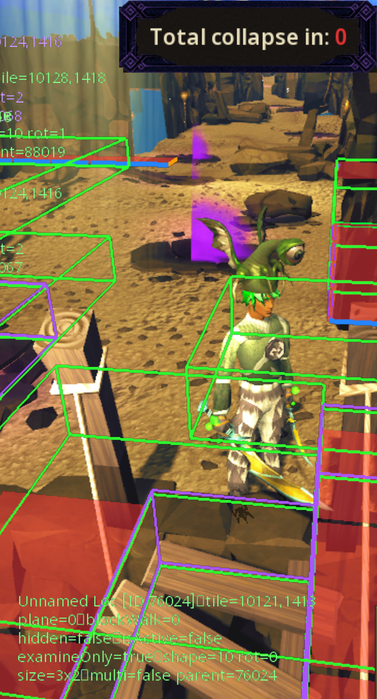
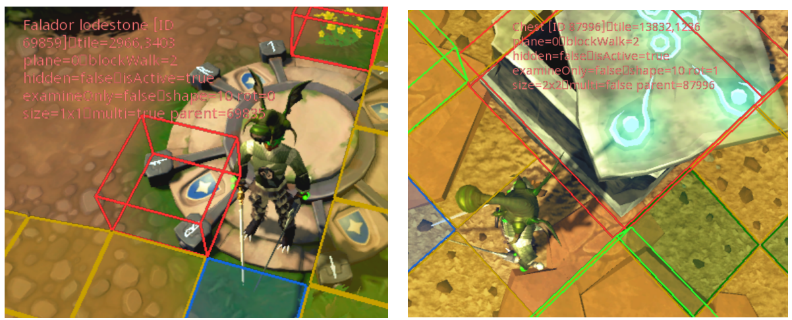
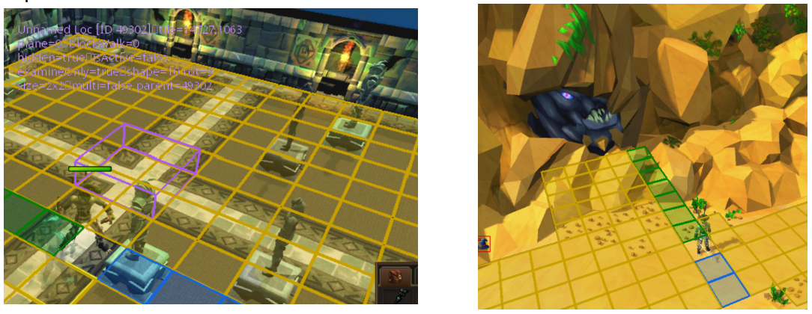

# **<u>Dive Plugin: Current Known Limitations</u>** 

## **1. Objects that add central collision on a free tile even though their blockwalk is 0 or they are hidden.** 

I currently have a hardcoded list of objects that **_add_** collision, because they block movement in game, but their blockwalk is set to 0. Currently this is just the broken ROTS bridge, dg statues and some dg doors. 

<figure style="display: inline-block; margin: 0;">
  
  <figcaption style="font-style: italic; color: #555; max-width: 1000px;">
    The ROTS Broken Bridge has "walkable" properties and no cache collision even though I can't cross
  </figcaption>
</figure>

## **2. Objects with opposite behaviors but identical Loc parameters.** 

There are some cases where objects with exactly identical loc properties act in opposite ways. To that end, I just had to pick which one I wanted the heuristics to follow. One example is this weird tile next to lodestones, which has blockWalk=2 but is walkable. Whereas the rots loot chest has identical properties, but is not walkable. I’ve left the lodestone tile _blocking_ for the time being. 

<figure style="display: inline-block; margin: 0;">
  
  <figcaption style="font-style: italic; color: #555; max-width: 1000px;">
    Identical LocEntity parameters with opposite collision behaviors
  </figcaption>
</figure>

## **3. NPCs that block collision** 

The current API doesnt expose if NPCs block movement or not. There are some NPCs such as Vorago’s face and the dungeoneering push statues (these are NPCs not Locs!) that do not expose their collision. 

<figure style="display: inline-block; margin: 0;">
  
  <figcaption style="font-style: italic; color: #555; max-width: 1000px;">
    NPCs that should block collision
  </figcaption>
</figure>

## **4. Uncharted isles and other 1x1 Procedural zones.** 

My current zone rotation detection assumes procedural zones stitch zones in 2x2 fashion. But this is not always true, and in uncharted isles it’s a 1x1 stitch. Until Jagex implements an API method that provides the orientation of the currently active zone, these types of instances will be unsupported. 

