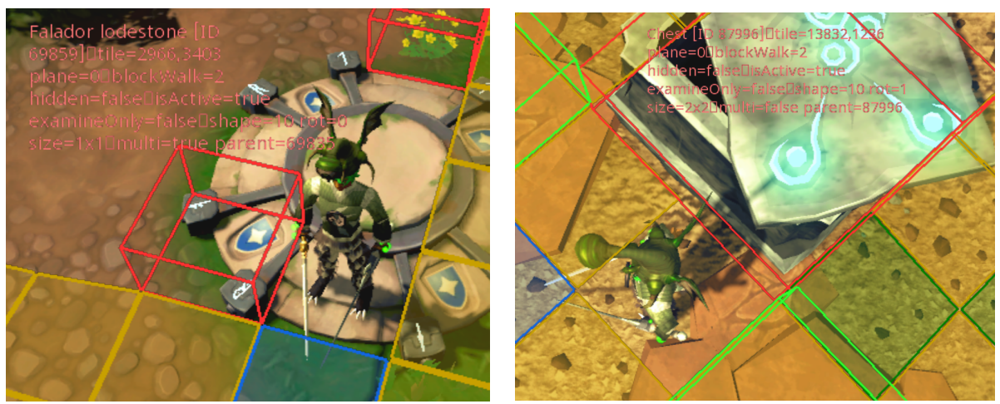

# **<u>Dive Plugin: Current Known Limitations</u>**

## **1. NPCs that block collision**

The current API doesnt expose if NPCs block movement or not. There are some NPCs such as Vorago’s face and the dungeoneering push statues (these are NPCs not Locs!) that do not expose their collision.

<figure style="display: inline-block; margin: 0;">
  
  <figcaption style="font-style: italic; color: #555; max-width: 1000px;">
    NPCs that should block collision
  </figcaption>
</figure>

## **3. Uncharted isles and other 1x1 Procedural zones.**

My current zone rotation detection assumes procedural zones stitch zones in 2x2 fashion. But this is not always true, and in uncharted isles it’s a 1x1 stitch. Until Jagex implements an API method that provides the orientation of the currently active zone, these types of instances will be unsupported.

